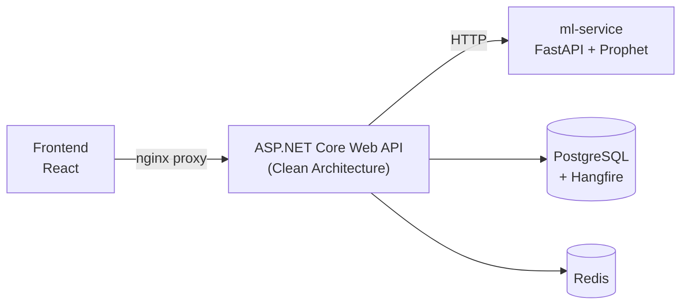

# TimeSeriesForecaster

[](https://github.com/Gulnihalv/TimeSeriesForcaster/actions/workflows/ci.yml)

Zaman serisi verilerini yükleyip görselleştiren, üzerinde Prophet tabanlı tahmin
modelleri eğiten ve sonuçları karşılaştıran full-stack bir tahminleme platformu.

CSV olarak yüklenen veri seti arka planda işlenir, model eğitimi kuyruğa alınır,
eğitim bitince tahminler ve model bileşenleri arayüzde görselleştirilir.

## Özellikler

- Proje ve veri seti yönetimi, JWT ile kimlik doğrulama
- 100 MB+ CSV desteği — akış halinde okuma ve PostgreSQL'e binary COPY ile yazma
- Milyonlarca satırın SQL tarafında downsample edilerek grafiklenmesi
- Model eğitimi öncesi saatlik / günlük / haftalık / aylık toplulaştırma
- Hangfire ile arka plan işleri; ilerleme takibi ve iptal
- Ayarlanabilir Prophet hiperparametreleri, holdout üzerinden MAE / RMSE
- En fazla 4 modelin karşılaştırılması, trend ve mevsimsellik ayrıştırması
- HybridCache (bellek + Redis) ile önbellekleme

## Mimari



Backend `Domain` / `Application` / `Infrastructure` / `WebAPI` katmanlarına ayrılmıştır.

## Teknolojiler

.NET 10 · EF Core + Npgsql · Hangfire · Serilog · PostgreSQL 17 · Redis
Python 3.11 · FastAPI · Prophet
React 19 · TypeScript · Vite · Zustand · Recharts
Docker Compose · nginx · xUnit · GitHub Actions

## Çalıştırma

Repo kökünde bir `.env` dosyası oluştur:

```env
POSTGRES_PASSWORD=<parola>
JWT_SECRET=<en az 32 karakterlik rastgele dize>
```

```bash
docker compose up -d --build
```

| | |
|---|---|
| Frontend | http://localhost:3000 |
| API (Swagger) | http://localhost:5000/swagger |
| Hangfire paneli | http://localhost:5000/hangfire |

## Testler

```bash
dotnet test
```
